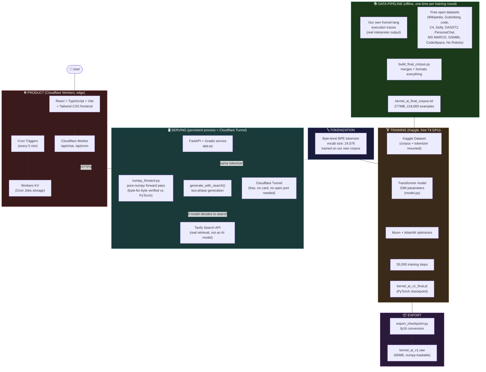
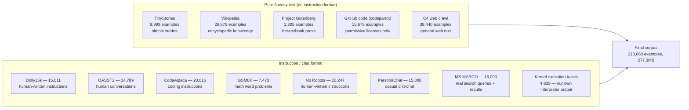
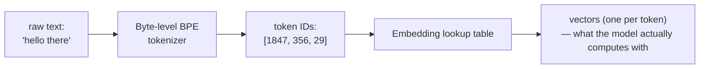
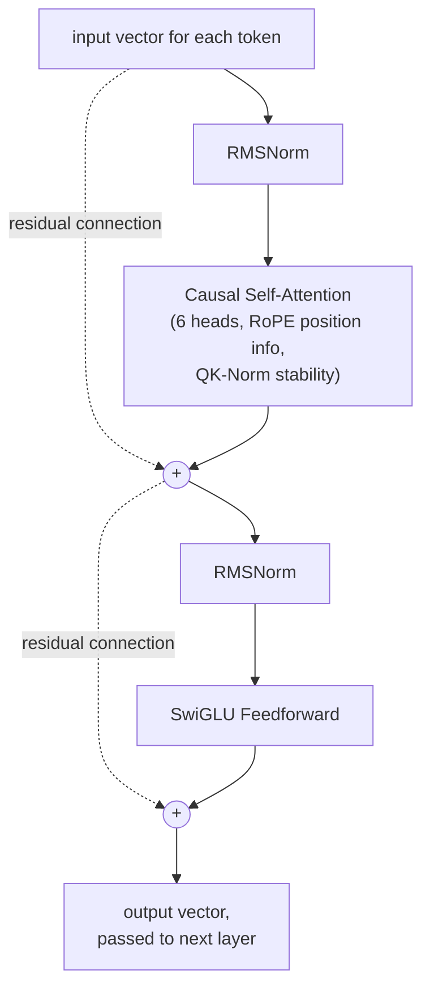
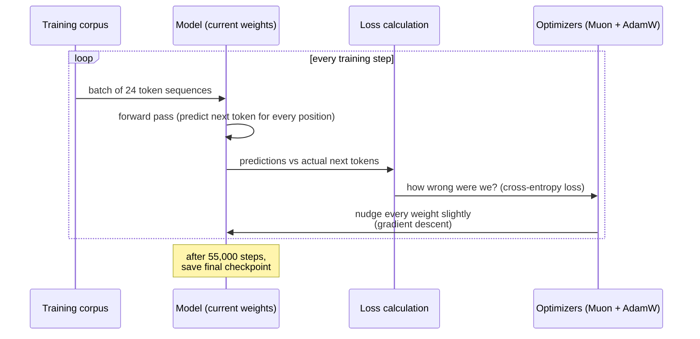
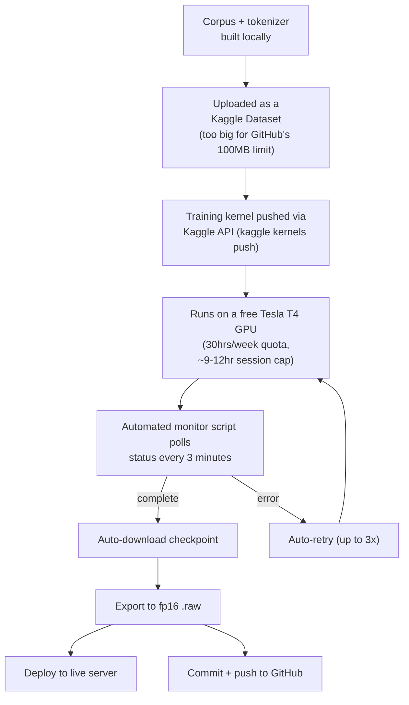
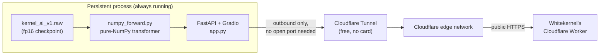
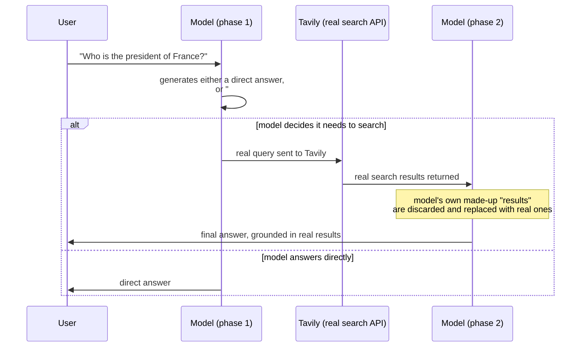
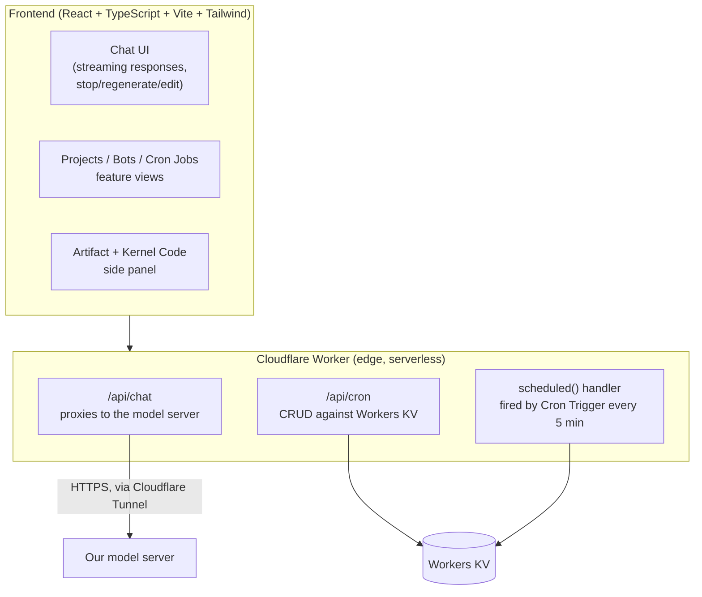
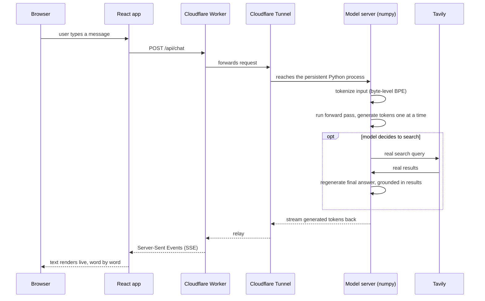

# Whitekernel LLM — Complete Technical Guide

**A from-scratch large language model, trained on 100% free and open data, with no existing AI model involved anywhere in its creation.**

This document explains everything: what was built, why, how all the pieces fit together, every technical term used, and how this compares to how ChatGPT and Claude are actually built. It's written so both a non-technical reader and an engineer can follow it end to end.

---

## Table of Contents

1. [The 30-Second Version](#1-the-30-second-version)
2. [The Core Rule This Whole Project Follows](#2-the-core-rule-this-whole-project-follows)
3. [Full System Diagram](#3-full-system-diagram)
4. [Glossary — Every Term Used, Defined](#4-glossary--every-term-used-defined)
5. [Part A: The Data](#5-part-a-the-data)
6. [Part B: The Tokenizer](#6-part-b-the-tokenizer)
7. [Part C: The Model Architecture](#7-part-c-the-model-architecture)
8. [Part D: Training](#8-part-d-training)
9. [Part E: Export + Serving](#9-part-e-export--serving)
10. [Part F: The Product (Frontend + Backend Glue)](#10-part-f-the-product-frontend--backend-glue)
11. [End-to-End Request Flow](#11-end-to-end-request-flow)
12. [How This Compares to GPT / Claude / Llama](#12-how-this-compares-to-gpt--claude--llama)
13. [Version History](#13-version-history)
14. [Where Everything Lives (Repo Map)](#14-where-everything-lives-repo-map)
15. [Honest Limitations](#15-honest-limitations)

---

## 1. The 30-Second Version

We built a working chat AI — "Whitekernel" — the same way ChatGPT and Claude are built, just at a much smaller scale:

1. Collected real, free, human-written text (books, Wikipedia, code, conversations, Q&A) — **218,660 examples, 277MB**
2. Converted that text into numbers a computer can do math on (**tokenization**)
3. Built a neural network (**the Transformer architecture** — the same blueprint behind every modern LLM) with **33 million** adjustable numbers (**weights**)
4. Repeatedly showed it examples and nudged those 33 million numbers until it got good at predicting the next word (**training**, on a free cloud GPU)
5. Packaged the trained numbers into a file anyone can run (**the checkpoint**)
6. Built a way to actually talk to it: a public website, a server running the model, real web search when it needs facts

No part of this used an existing AI model (ChatGPT, Claude, or anything else) to generate training data, write any code's logic, or answer end users. Every number the model ever produces comes from its own training.

---

## 2. The Core Rule This Whole Project Follows

> **Our own model answers every user, every time. Never a hosted/existing AI model. Never AI-generated training data.**

This rule shaped almost every engineering decision in this project:

- When Cloudflare Workers' free tier couldn't run the model fast enough, the fix was a **Cloudflare Tunnel to our own server** — not switching to a hosted model API.
- When building "web search" capability, the chosen API (**Tavily**) is a pure **retrieval** service (it returns raw search results, it does not generate text with an AI model) — so wiring it in doesn't violate the rule.
- Every training dataset is either a real open dataset built by humans (Wikipedia, Reddit threads, crowdsourced conversations, real Bing search logs) or data generated by literally running our own Kernel programming language's interpreter — never text written by another AI.

---

## 3. Full System Diagram



**Walkthrough — read this left to right, top to bottom:**

The diagram has six colored zones, and data flows through them in order, like a factory line:

1. **📚 Data pipeline (green)** — two different kinds of input come together here. The free open datasets (left box) are things other people/organizations built; our own Kernel-lang execution traces (right box) come from running our own programming language's interpreter. A single script, `build_final_corpus.py`, reads all of it and merges it into one 277MB text file — this file is the *only* thing training ever sees.
2. **🔤 Tokenization (blue)** — before that text file can be used, it has to pass through the tokenizer, which turns text into numbers. Notice the tokenizer box sits between data and training *and* has a second connection (dotted line) all the way over to the serving box — that's because the exact same tokenizer has to be used both when training the model and later when running it, otherwise the numbers wouldn't mean the same thing.
3. **🏋️ Training (orange)** — the corpus and tokenizer both get mounted into a Kaggle training run. The model (33M parameters) runs through the data for 55,000 steps, with the Muon+AdamW optimizers doing the actual weight-nudging. Out the other end comes `kernel_ai_v1_final.pt` — a frozen snapshot of every trained number.
4. **📦 Export (purple)** — that PyTorch checkpoint gets converted into a smaller, framework-independent format (fp16 `.raw` file) — this is the bridge between "trained on a GPU with PyTorch" and "served anywhere with just NumPy."
5. **🖥️ Serving (teal)** — the exported checkpoint loads into `numpy_forward.py`, wrapped by a FastAPI service. When a question needs real facts, that service can reach out to Tavily (dotted line, "if model decides to search") — this is the only place anything outside our own trained weights touches the answer, and it's pure search, not another AI model. A Cloudflare Tunnel gives this whole thing a public address.
6. **🌐 Product (red)** — this is what you actually see: a website built in React, backed by a Cloudflare Worker that either talks to Workers KV (for saved Cron Jobs) or forwards your chat message over HTTPS, through the tunnel, down into the serving layer.

Follow the arrow from **👤 User** at the bottom-left: you talk to the React frontend, which talks to the Worker, which reaches through the tunnel into the actual model. Everything to the right of "SERVING" only exists because of everything built in the four boxes to its left.

---

## 4. Glossary — Every Term Used, Defined

Organized so you can jump to the category you need. Every term here is explained in plain language first, then with the technical detail.

### Core AI/ML concepts

| Term | Plain-language definition | Why it matters here |
|---|---|---|
| **LLM (Large Language Model)** | A program that's been trained on huge amounts of text to predict "what word comes next," and gets good enough at this that it can hold conversations, answer questions, and write code. | This entire project. |
| **Neural network** | A mathematical function built from layers of simple operations (mostly multiplication and addition) stacked on top of each other, with adjustable numbers controlling how they combine. | The underlying machinery of the LLM. |
| **Parameter / Weight** | One single adjustable number inside the neural network. Our model has ~33 million of them. | Training = adjusting these. The trained model **is** this set of numbers. |
| **Training** | The process of repeatedly showing the model examples, checking how wrong its prediction was, and nudging every weight slightly to make it less wrong next time. | How the model goes from random noise to something that can write a sentence. |
| **Inference** | Using an already-trained model to actually produce an answer (as opposed to training it). | What happens every time you send Whitekernel a message. |
| **Gradient descent** | The specific mathematical method used to figure out *which direction* to nudge each weight during training (follow the slope of the error downhill). | The core training algorithm, present in every modern LLM, including GPT/Claude. |
| **Loss function** | A single number that measures "how wrong" the model's prediction was for one example. Training tries to make this number as small as possible. | We use **cross-entropy loss**, the standard choice for next-token prediction. |
| **Epoch / Step** | A "step" is one batch of examples processed and one weight update. We don't train in full epochs (full passes over the data) — we train for a fixed number of **steps** instead (e.g. 55,000). | How training progress is measured and compared across runs. |
| **Checkpoint** | A saved snapshot of all the model's weights at a point in training, so you can resume or deploy from there. | `kernel_ai_v1_final.pt` is our checkpoint. |
| **Overfitting** | When a model memorizes its training examples instead of learning general patterns — looks great on training data, bad on anything new. | Why we hold back a small **validation split** (2% of data never trained on) to check for this. |
| **Context window** | The maximum number of tokens the model can "see" at once when generating a response. | Ours is **256 tokens** — small by modern standards (GPT-4 class models use 32K-200K+), a direct consequence of training on a free GPU with a 33M-parameter model. |

### Transformer architecture terms

| Term | Plain-language definition | Why it matters here |
|---|---|---|
| **Transformer** | The specific neural network architecture (introduced 2017, "Attention Is All You Need") that all modern LLMs are built on. Its key idea: every token can directly look at every other token via "attention," instead of processing text strictly one word at a time like older architectures. | This is literally the architecture GPT, Claude, Llama, Gemini — and our model — all use. |
| **Decoder-only** | A Transformer variant that only ever predicts the *next* token from everything *before* it (left-to-right), with no separate "encoder" half. | The standard shape for a chat/generation model (as opposed to BERT-style encoders used for classification). |
| **Attention / Self-attention** | The mechanism that lets each token "look at" every earlier token and decide how much each one matters for predicting what comes next. | The core innovation that makes Transformers work well. |
| **Causal masking** | A rule applied to attention that blocks a token from looking at anything *after* it — otherwise the model could "cheat" by peeking at the answer. | What makes this a valid left-to-right generator. |
| **Multi-head attention** | Instead of computing attention once, the model splits it into several smaller parallel "heads," each potentially learning a different kind of relationship (e.g., one head might track grammar, another might track topic). We use **6 heads**. | More expressive than a single attention computation at the same total size. |
| **Embedding** | A lookup table that converts each token ID (a number) into a vector (a list of numbers) that represents its meaning in a way the network can do math on. | The very first step inside the model, `tok_emb` in our code. |
| **RoPE (Rotary Position Embeddings)** | A technique for telling the model *where* each token is in the sequence, by rotating its vector by an angle based on position, baked directly into the attention math. | Used instead of older "add a position number" schemes because it generalizes better. Used in LLaMA and most current models. |
| **RMSNorm** | A normalization step (keeps numbers from growing too large or small as they flow through many layers) that's cheaper than the older "LayerNorm" because it skips centering the data around zero. | Used throughout our model; also used in LLaMA, Mistral, and most current open models. |
| **QK-Norm** | Normalizing the "Query" and "Key" vectors (used inside attention) before computing attention scores — a stability trick that keeps training from blowing up. | Added specifically to keep training numerically stable at this scale. |
| **SwiGLU** | The activation function used in the model's feedforward layers. Instead of a simple on/off switch (like ReLU), it's a "gated" function — one branch of the computation controls how much of another branch gets through. | Used in PaLM, LLaMA, and most current frontier models; consistently outperforms older activations. |
| **Feedforward network (FFN)** | A small two-layer network applied to each token individually (after attention mixes information *between* tokens, the FFN processes each token's resulting vector on its own). | Roughly half of a Transformer's total computation happens here. |
| **MoE (Mixture of Experts)** | Instead of one feedforward network, you have several ("experts") and a small router that picks which 1-2 handle each token — lets you scale up total parameters without scaling up compute per token. | Built into our architecture as an *option* (currently switched off, `use_moe=False`) — future headroom if we scale up. GPT-4 and several other frontier models reportedly use MoE. |
| **Zero-init output head** | The final layer (which turns the model's internal representation into "which word comes next" probabilities) starts at all zeros instead of random numbers. | A training-stability trick for small models, loosely related to a technique called **muP** (maximal update parametrization). |

### Tokenization terms

| Term | Plain-language definition | Why it matters here |
|---|---|---|
| **Token** | A chunk of text — could be a whole word, part of a word, or a single character/byte — that gets mapped to one number. | The actual unit the model "thinks" in; not the same as a word. |
| **Tokenization** | The process of splitting text into tokens and converting each to a number, before anything else can happen. | The very first step of both training and inference. |
| **BPE (Byte-Pair Encoding)** | An algorithm that starts from individual characters/bytes and repeatedly merges the most common adjacent pair into a new token, thousands of times, until reaching a target vocabulary size. | The algorithm our tokenizer uses — also the same family of algorithm GPT (`tiktoken`) and Claude use. |
| **Byte-level** | A BPE variant that starts from raw bytes rather than characters — meaning it can represent *any* text (any language, emoji, unusual symbols) without ever failing. | Our tokenizer is byte-level, so it never hits an "unknown token" error. |
| **Vocabulary / Vocab size** | The total number of unique tokens the tokenizer knows. Ours is **24,576**. | A design choice balancing efficiency (bigger vocab = fewer tokens per sentence) against model size (bigger vocab = bigger embedding table). GPT-4's vocab is ~100K+; ours is intentionally smaller to match our smaller model. |
| **Special token** | A token reserved for a specific structural purpose rather than representing normal text. `<|endoftext|>` (our EOS token) marks the end of a document/response. | The model is trained to emit `<|endoftext|>` when it's done answering — this is how it knows to stop. |

### Training infrastructure terms

| Term | Plain-language definition | Why it matters here |
|---|---|---|
| **Optimizer** | The algorithm that actually performs the "nudge the weights" step during training, using the calculated gradients. | We use two, split by parameter type (see below). |
| **Muon** | A modern (2024) optimizer that "orthogonalizes" its updates for 2D weight matrices via a mathematical trick (Newton-Schulz iteration) — keeps updates balanced across directions rather than all piling into one. | Used for all the big 2D weight matrices in our model. |
| **AdamW** | The standard, widely-used adaptive-learning-rate optimizer, with weight decay (a regularization technique) handled separately from the gradient update. | Used for everything that isn't a big 2D matrix (embeddings, normalization weights, the output head). |
| **Learning rate** | How big a step the optimizer takes when nudging a weight. Too high = training becomes unstable; too low = training takes forever. | We use different learning rates for Muon (0.02) and AdamW (0.0003) — a known effective combination. |
| **Batch size** | How many training examples get processed together before one weight update. Ours is 24. | Bigger batches = more stable gradient estimates, but more memory needed per step. |
| **GPU (Graphics Processing Unit)** | A chip originally built for rendering graphics, now the standard hardware for training neural networks because it can do many small calculations in parallel. | We train on a free **Tesla T4** GPU via Kaggle. |
| **Kaggle Notebooks** | A free, Google-adjacent platform offering free GPU time (30 hours/week quota) for running code, originally built for data science competitions. | Where all our training actually runs. |
| **Kaggle Dataset** | A versioned file storage system on Kaggle, separate from notebooks — used to store our training corpus (277MB, too big for GitHub's 100MB file limit) and mount it into a training run. | How the training script actually gets access to our corpus. |

### Serving/infrastructure terms

| Term | Plain-language definition | Why it matters here |
|---|---|---|
| **Serving / Inference server** | The running process that holds the trained model in memory and answers real requests. | Our Python (FastAPI) process, always running on a persistent machine. |
| **NumPy** | A Python library for fast numerical array math — much lighter-weight than a full deep-learning framework. | We reimplemented the model's entire forward pass in pure NumPy (`numpy_forward.py`) so it can run without needing PyTorch installed at serving time. |
| **fp16 (half precision)** | Storing each weight using 16 bits instead of the usual 32 (fp32) — half the file size and memory, with a small, carefully-verified loss of precision. | Our deployed checkpoint is fp16, verified to differ from the full-precision version by a tiny, negligible amount. |
| **Cloudflare Workers** | A "serverless" platform — your code runs on Cloudflare's global network on-demand, scaling to zero cost when nobody's using it. | Hosts our actual website and API routing. |
| **Serverless** | A deployment style where you don't manage a server yourself — the platform runs your code only when needed and you're billed (or not, on the free tier) only for that. | Why hosting Whitekernel's frontend costs nothing when nobody's visiting. |
| **CPU time limit** | A cap on how many milliseconds of actual processor time a single request is allowed to use. Cloudflare Workers' free tier caps this at **10 milliseconds** — far too little for a transformer forward pass. | The reason the actual model can't run *inside* a Worker, and needs a separate persistent server. |
| **Cloudflare Tunnel** | A tool that creates a secure outbound-only connection from a machine you control to Cloudflare's network, which then exposes it with a real public HTTPS address — without ever opening an inbound port or needing a static IP. | How our model-serving process (on a regular machine) gets a real public URL, for free, with no credit card. |
| **Workers KV** | A key-value database built into Cloudflare Workers. | Stores Cron Job definitions so they survive even when no browser tab is open. |
| **Cron Trigger** | A scheduled, recurring invocation of a Worker (e.g., "run this every 5 minutes"), independent of any user visiting the site. | Powers the "Cron Jobs" feature — scheduled prompts that run server-side. |
| **Retrieval / Search API** | A service that returns real search results for a query — it does *not* generate text with an AI model, it just finds and returns existing web content. | **Tavily**, used for Whitekernel's web-search capability — chosen specifically because it's retrieval, not generation, so using it doesn't violate the "no existing AI model" rule. |

### Frontend/product terms

| Term | Plain-language definition | Why it matters here |
|---|---|---|
| **React** | A JavaScript library for building user interfaces out of reusable "components" instead of hand-writing HTML/CSS/JS by hand for every piece. | What Whitekernel's chat interface is built in — the same category of tool Claude.ai and ChatGPT's own interfaces use. |
| **TypeScript** | JavaScript with an added type system (catches a class of bugs before the code even runs). | Used for both the frontend and the Cloudflare Worker backend code. |
| **Vite** | A fast build tool that bundles all the frontend code (React components, CSS, etc.) into the small set of files a browser actually needs. | Converts our source code into what actually gets deployed. |
| **Tailwind CSS** | A styling approach where you compose small utility classes (like `text-white`, `rounded-xl`) directly in your markup instead of writing separate CSS files. | Used for all of Whitekernel's visual design. |
| **SSE (Server-Sent Events)** | A simple protocol for a server to stream a sequence of small messages to a browser over time, over a single connection. | How the model's response appears to "type itself out" word by word in the chat UI. |
| **Markdown rendering** | Converting plain-text formatting marks (like `**bold**` or ```` ```code``` ````) into properly styled text/code blocks in the browser. | How code blocks, tables, and formatting in the model's responses actually display nicely. |

---

## 5. Part A: The Data

### 5.1 Philosophy

Every example the model trains on falls into exactly one of two buckets:

1. **A free, open, human-authored dataset** (built by researchers, crowdworkers, or real logged human activity — never generated by an AI model)
2. **Our own Kernel programming language's execution traces** — real source code run through our own interpreter, paired with its real output

Nothing in the corpus was written by ChatGPT, Claude, or any other AI model.

### 5.2 Every data source, and its purpose



**Walkthrough**: this diagram is really just a bar chart in disguise, grouped into two families. The left group (TinyStories through C4) is text with *no* question/answer structure — the model just reads it as flowing prose to learn grammar, facts, and different writing styles. The right group (Dolly through Kernel execution traces) is all in the Instruction→Response shape described below. Both groups funnel into the same final corpus file — the model doesn't "know" which group a given example came from, it just sees more of this pattern or more of that one. The relative *size* of each box matters more than it might look: OASST2 (34,789) and C4 (39,440) are the two largest single contributors, so they have outsized influence on the model's general "voice," which is part of why PersonaChat (casual chat) and MS MARCO (search behavior) were added deliberately in smaller, targeted amounts — to steer specific behaviors without being overwhelmed by the bigger, more generic sources.

| Source | Count | Purpose |
|---|---|---|
| TinyStories | 9,999 | Basic fluency/grammar — deliberately capped small; at full size it dominated and made the model default to "continue the story" for every prompt, including greetings |
| Wikipedia | 26,876 | Encyclopedic world knowledge |
| Project Gutenberg | 1,305 | Literary prose register (different from everything else in the mix) |
| GitHub code (codeparrot) | 15,675 | Real code syntax exposure, filtered to permissive licenses (MIT/Apache-2.0/BSD/ISC) and excluding auto-generated files |
| C4 web crawl | 39,440 | General web-register text |
| Dolly15k | 15,011 | Human-written instruction-following examples |
| OASST2 | 34,789 | Real multi-turn human conversations |
| CodeAlpaca-20k | 20,016 | Coding instruction/response pairs |
| GSM8K | 7,473 | Math word problems with worked solutions |
| No Robots | 10,247 | Human-written instructions (built specifically to prove a dataset doesn't need AI-generated data) |
| PersonaChat | 15,000 | Ordinary human small talk — added specifically because nothing else taught the model how to just chat casually |
| MS MARCO | 18,000 | Real Bing search-query logs + real retrieved passages + human-written answers — teaches the "search when you need facts" pattern |
| Kernel-lang execution traces | 4,829 | Our own programming language's semantics, taught via real interpreter runs, not description |

### 5.3 How it's all merged into one format

A script (`data/build_final_corpus.py`) reads every source and converts it into one of these text shapes, separated by the `<|endoftext|>` token:

```
### Instruction:
{question or task}

### Response:
{answer}
```

```
### Context:
{optional background/persona instructions}

### Instruction:
{question}

### Response:
{answer}
```

```
### Instruction:
{question}

### Search:
{search query}

### Search Results:
{real retrieved passage}

### Response:
{answer grounded in those results}
```

The model never sees a special "chat mode" switch — it just learns this text pattern like any other sequence, via plain next-token prediction. The fact that it can hold a "conversation" at all is an emergent result of having seen enough examples of this pattern.

---

## 6. Part B: The Tokenizer



**Walkthrough**: read this as four stations on a conveyor belt. Raw text comes in on the left. The tokenizer doesn't understand English — it's just pattern-matching against its learned vocabulary of 24,576 chunks, so `'hello there'` becomes a short list of integers (the exact numbers shown are illustrative). Those integers aren't meaningful to the neural network either, on their own — an integer like 1847 doesn't encode any sense of "hello-ness." That's what the embedding table (far right) does: it's a lookup table, literally one row of 384 numbers per vocabulary entry, and *those* rows are what actually flow through the Transformer's math. This whole left-to-right chain happens every single time, both when training AND when answering a live question — it's the universal first step.

- **Algorithm**: Byte-level Byte-Pair Encoding (BPE)
- **Vocabulary size**: 24,576 tokens
- **Trained on**: our own corpus (not reused from GPT, Claude, or any other model)
- **Special token**: `<|endoftext|>` (token id 4) — marks the end of every document during training, and the model learns to emit it when its response is complete, which is how generation knows when to stop.

**Why byte-level matters**: a byte-level tokenizer can represent *any* possible text — any language, emoji, unusual symbol — by falling back to raw bytes in the worst case. It can never produce an "unrecognized token" error, unlike older word-based tokenizers.

---

## 7. Part C: The Model Architecture

### 7.1 Overview

- **Type**: Decoder-only Transformer
- **Parameters**: 33,037,696 (~33M)
- **Layers**: 8
- **Model dimension**: 384
- **Attention heads**: 6 (so each head handles 64 dimensions)
- **Feedforward dimension**: 1,024
- **Context window**: 256 tokens
- **Framework**: PyTorch (for training); a hand-written pure-NumPy reimplementation for serving

### 7.2 What happens inside one Transformer block



**Walkthrough**: this is the single repeating unit that, stacked 8 times, makes up the entire model — understanding this one diagram means understanding the whole architecture. Each token's vector flows in at the top. It gets normalized (RMSNorm), then passed through self-attention, where it "looks at" every earlier token in the sequence to gather context (this is where RoPE tells it *where* each token is, and QK-Norm keeps the math stable). The dotted line labeled "residual connection" is important: the ORIGINAL input gets added back on top of the attention's output (the "+" circle) — this means the layer only has to learn a *correction* to add, not reconstruct the whole signal from scratch, which is a big part of why deep networks like this are trainable at all. The same pattern repeats for the second half: normalize, run through the SwiGLU feedforward network (which processes each token independently, no longer looking at other tokens), add the residual back. What comes out the bottom becomes the input to the next identical block. After block 8, one final RMSNorm and a linear layer turn the result into a probability for every possible next token.

### 7.3 The specific design choices, and why

| Choice | What it replaces | Why we used it |
|---|---|---|
| RoPE (Rotary Position Embeddings) | Learned absolute position embeddings | Encodes relative position directly into attention math; generalizes better to different sequence lengths. Used in LLaMA and most current open models. |
| RMSNorm | LayerNorm | Cheaper (skips mean-centering), same stabilizing effect. Used in LLaMA, Mistral, and most current open models. |
| QK-Norm | (nothing, in older architectures) | Normalizes attention's Query/Key vectors before the dot product — keeps training numerically stable, especially important at small scale with aggressive learning rates. |
| SwiGLU | ReLU / GeLU feedforward | A "gated" activation that consistently outperforms simpler ones at the same parameter count. Used in PaLM, LLaMA. |
| Zero-init output head | Random initialization | Starts the final layer at all zeros for training stability at this parameter scale (muP-adjacent technique). |
| Optional MoE (currently off) | A single dense feedforward | Built in as architecture headroom — lets the model scale total capacity without scaling compute per token, if we ever train a bigger version. |

### 7.4 Weights — what they actually are

The 33,037,696 parameters are organized as:
- `tok_emb.weight` — the embedding table (24,576 vocab × 384 dimensions)
- Per layer (×8): attention's QKV projection, output projection, Q-norm, K-norm, two RMSNorm weights, SwiGLU's three weight matrices
- `norm_f.weight` — final normalization
- `head.weight` — the output projection back to vocabulary size

All of these together **are** the model. The `.pt` (PyTorch) and `.raw` (our custom fp16 export) files are just this list of numbers saved to disk.

---

## 8. Part D: Training

### 8.1 The training loop, conceptually



**Walkthrough**: this is a sequence diagram — time flows downward, and each arrow is one message between the four participants. The `loop` box means this entire sequence repeats, once per training step, 55,000 times over. Read it as: the corpus hands the model a small batch (24 sequences); the model makes its best guess at the next token for every position in that batch (this is "the forward pass"); those guesses get compared against what the actual next tokens really were, producing one loss number; that loss number tells the optimizers how wrong things were; the optimizers then reach back and adjust every single one of the model's 33 million weights by a tiny amount in the direction that would've made this batch's guesses less wrong. Step 1 of 55,000 starts with a model that's basically random noise; by step 55,000, those repeated tiny nudges have shaped it into something that can hold a conversation. No individual step teaches it much — it's the sheer repetition that matters.

### 8.2 Optimizers

We split parameters between two different optimizers — a known effective technique (from the "modded-nanogpt" community/convention):

- **Muon** (for all 2D hidden weight matrices — attention and feedforward weights): orthogonalizes each update via a Newton-Schulz iteration, keeping updates balanced across directions. Learning rate: 0.02.
- **AdamW** (for everything else — embeddings, norm weights, the output head): the standard adaptive optimizer with decoupled weight decay. Learning rate: 0.0003.

### 8.3 Training infrastructure



**Walkthrough**: this is the automation loop that ran unattended, including overnight, for every training round. Starting top-left: once a corpus is built locally, it gets uploaded to Kaggle as a Dataset (not a regular git commit — GitHub rejects anything over 100MB, and our corpus is 277MB). A training kernel (Kaggle's term for a running script) gets pushed via their API, mounts that dataset, and starts using the free T4 GPU. From there, a monitor script I wrote checks in every 3 minutes without needing a human watching. Two branches out of that check: if the status comes back "complete," it automatically downloads the checkpoint and moves on to export/deploy/commit. If it comes back "error" instead, it automatically retries (re-pushing the same kernel) up to 3 times before giving up — this loop-back arrow (G → D) is the safety net that lets a multi-hour training run survive a transient failure without needing a person watching it the whole time.

### 8.4 A real engineering problem we hit and fixed

When the corpus grew to 277MB, tokenizing it as a single giant string spiked memory usage past Kaggle's limit and the Linux kernel killed the process (visible in logs only as `Killed`, no Python error). Fixed by batching the tokenization per-document instead of all at once — verified correct and **5x faster** on a real sample before relaunching. This is a genuine example of an engineering problem surfacing only at a larger data scale, found and fixed with evidence, not guessed at.

---

## 9. Part E: Export + Serving

### 9.1 Why serving needed its own design problem solved

The obvious approach — put the model inside a Cloudflare Worker — doesn't work: Cloudflare Workers' free tier caps **CPU time at 10 milliseconds per request**, nowhere near enough for even a small transformer's forward pass. This was discovered via a real failed deployment attempt, not assumed in advance.

### 9.2 The actual serving architecture



**Walkthrough**: reading left to right, this shows two very different kinds of infrastructure stitched together. The left box ("persistent process") is a single, ordinary machine that never stops running — it loads the checkpoint once into memory, and every request after that just runs the numbers through `numpy_forward.py` and returns an answer. The arrow out of that box ("outbound only, no open port needed") is the key trick: that machine reaches *out* to Cloudflare through the tunnel, rather than Cloudflare reaching *in* to it — which is why it doesn't need a public IP address, a firewall rule, or any paid hosting. Cloudflare's own network then exposes that connection as a normal public HTTPS address, which is what the Worker (the actual website, on the far right) talks to. The practical effect: the model genuinely runs on a normal computer, but anyone on the internet can reach it through a real `https://` URL, for $0.

- **`numpy_forward.py`** is a complete, independent reimplementation of the model's forward pass using only NumPy — no PyTorch required at serving time. It was verified **byte-for-byte identical** to the PyTorch version before being trusted in production.
- **fp16 export**: the checkpoint is converted from 32-bit to 16-bit floating point, halving its size (66MB vs ~132MB), with precision loss verified to be negligible (max difference ~0.0077 vs the full-precision version).
- **Cloudflare Tunnel** connects this always-on process to a real public URL without ever needing to open an inbound port, get a static IP, or pay for anything.

### 9.3 Web search (tool use)



**Walkthrough**: this diagram's `alt`/`else` box is the whole point — it shows a genuine fork in behavior, not a fixed script. "Model (phase 1)" generates its *first* attempt at a response, and whether that attempt starts with `### Search:` or jumps straight to an answer is entirely up to whatever the model itself learned to do for that specific question — nobody hardcoded a list of "questions that need search." If it did choose to search, notice the discarded step in the middle: the model's own phase-1 attempt at "search results" gets thrown away completely (it was never a real search, just the model pattern-matching what results usually look like) and replaced with Tavily's real, actual results before "Model (phase 2)" writes the real final answer. If it didn't choose to search, the whole middle branch is skipped and the first attempt simply is the answer. Either way, Tavily only ever returns raw search results — it never writes the user-facing answer itself.

---

## 10. Part F: The Product (Frontend + Backend Glue)



**Walkthrough**: the top box is everything you directly see and click on — the chat itself, plus three extra feature areas (Projects for grouping chats, Bots for custom personas, Cron Jobs for scheduled prompts, and a side panel for code/artifacts). None of that frontend code talks to the model directly; it only ever talks to "its own" Cloudflare Worker, which exposes three jobs: forwarding chat messages on to the real model server, reading/writing Cron Job data in Workers KV (a small database), and running on its own schedule (independent of any visitor) to check whether any Cron Jobs are due. Notice `/api/cron` and the `scheduled()` handler both point at the same KV store — that's what lets a job you create in the UI actually get picked up and run later, even if you've closed the tab entirely. Only `/api/chat` ever reaches outside Cloudflare's network, down into the actual model server from the previous diagram.

- **React** — component-based UI (same category of tool Claude.ai/ChatGPT's own interfaces use)
- **TypeScript** — adds a type system on top of JavaScript, used for both frontend and Worker code
- **Vite** — bundles the source code into deployable files
- **Tailwind CSS** — utility-class-based styling
- **Cloudflare Workers** — serverless edge compute, hosts the site and API routes, scales to $0 cost when idle
- **Workers KV** — stores Cron Job definitions so they persist even with no browser open
- **Cron Triggers** — Cloudflare's own scheduler, checks for due jobs every 5 minutes

---

## 11. End-to-End Request Flow



**Walkthrough**: this is the single most useful diagram if you want to trace "what actually happens when I hit send" — it ties together every other diagram in this document into one timeline. Your keystroke only ever reaches three things directly: the React app in your browser, which immediately hands off to the Worker. Everything from "Worker→Tunnel" onward is invisible to you and takes anywhere from under a second to several seconds depending on response length. The `opt` box in the middle is literally the same fork from the web-search diagram, just placed in context of the full round-trip — it's optional, and most requests skip it entirely. Notice the arrows going back up use a dashed line (`-->>`) instead of solid (`->>`) — in sequence-diagram convention that distinguishes a *response* flowing back from an *original request* flowing forward, which is a nice visual cue for "this is the reply, not a new request." The very last step, React rendering text "live, word by word," is why the chat feels like it's typing in real time — the server is actually streaming small chunks the whole way back, not sending one giant finished block at the end.

---

## 12. How This Compares to GPT / Claude / Llama

**The honest, direct answer: same blueprint, different scale.** There is no secret alternative architecture behind GPT/Claude — every production LLM today, including ours, is a decoder-only Transformer trained via gradient descent into a set of weights, using BPE-family tokenization.

| Aspect | GPT-4 / Claude (frontier labs) | Whitekernel |
|---|---|---|
| Architecture family | Decoder-only Transformer | Decoder-only Transformer — same family |
| Position encoding | RoPE (or variants like ALiBi) | RoPE — same technique |
| Normalization | RMSNorm (in most current models) | RMSNorm — same technique |
| Feedforward activation | SwiGLU (in most current models) | SwiGLU — same technique |
| Tokenization | BPE-family (e.g. `tiktoken` for GPT) | Byte-level BPE — same family, own vocabulary |
| Training method | Gradient descent + large-scale RLHF/preference tuning | Gradient descent (supervised fine-tuning stage only — see below) |
| Parameters | Hundreds of billions to 1T+ (undisclosed exact figures) | 33 million |
| Training data | Trillions of tokens, web-scale + massive curated instruction/preference sets | 218,660 examples, ~70M tokens |
| Compute | Thousands of GPUs/TPUs, weeks to months | One free Tesla T4 GPU, hours per round |
| Context window | 32K–200K+ tokens | 256 tokens |

**What frontier labs do that we haven't done (yet):**
- **RLHF / DPO (preference tuning)** — a further training stage where the model is tuned against human preference comparisons ("which of these two replies is better?"), on top of basic instruction fine-tuning. We've only done the instruction fine-tuning stage so far. A genuinely free, 100%-human preference dataset exists for this (Stanford Human Preferences, built from Reddit upvotes) and is a real candidate for a future round.
- **Massive pretraining before instruction tuning** — frontier labs train a "base model" on trillions of tokens of raw text *before* ever showing it an instruction. We mix raw fluency text (TinyStories, Wikipedia, Gutenberg, code, C4) directly into the same training run as instruction data, rather than as a fully separate earlier phase — a simplification that's a direct consequence of our much smaller total data/compute budget.

**What's genuinely the same:** the math, the architecture family, the specific modern refinements (RoPE/RMSNorm/SwiGLU), the tokenization approach, and the training algorithm. The gap between us and GPT-4/Claude is honestly and entirely about **scale** — data volume, parameter count, and compute — not a different approach.

---

## 13. Version History

| Version | Steps | Corpus | Key addition |
|---|---|---|---|
| v1 (initial) | 6,000 | 98MB | First real trained checkpoint; val_loss 10.08 → 2.27 |
| v2 | 24,000 | 98MB (rebalanced) | Added No Robots + PersonaChat (human chit-chat); cut TinyStories from 27,630 → 9,999 examples (it had been dominating the mix) |
| v3 | 30,000 | 110MB | Added MS MARCO (real search-query/passage/answer triples) — the data foundation for tool-use/search capability |
| v4 | 55,000 | 277MB | Added Wikipedia, Project Gutenberg, GitHub code, and C4 web crawl — pretraining-scale raw text across four new registers |

Each round's checkpoint is committed to the repo at `checkpoints/kernel_ai_v1.raw` (fp16, ~66MB) along with its training log at `checkpoints/kernel_ai_v1_train_log.jsonl`.

---

## 14. Where Everything Lives (Repo Map)

```
kernel-llm/
├── data/
│   ├── build_final_corpus.py       — merges every source into the final training corpus
│   ├── scripts/                     — per-source conversion/sampling scripts
│   │   ├── convert_new_sources.py   — No Robots + PersonaChat → instruction pairs
│   │   ├── convert_ms_marco.py      — MS MARCO → search-pattern pairs
│   │   └── sample_pretrain_sources.py — Wikipedia/Gutenberg/code/C4 sampling
│   ├── raw/                         — downloaded/converted datasets (gitignored, too large)
│   └── kernel_ai_final_tokenizer.json — the trained byte-level BPE tokenizer
├── model/
│   ├── model.py                     — the Transformer architecture (PyTorch)
│   ├── muon.py                      — the Muon optimizer
│   ├── numpy_forward.py             — pure-NumPy reimplementation for serving
│   ├── train_kaggle_v1.py           — training script (reference copy)
│   └── export_checkpoint.py         — converts .pt checkpoints to fp16 .raw
├── hf_space/
│   └── app.py                       — the actual serving code (FastAPI + Gradio +
│                                        two-phase search generation)
├── checkpoints/
│   ├── kernel_ai_v1.raw             — the current deployed checkpoint
│   └── kernel_ai_v1_train_log.jsonl — training loss history
├── architecture/ARDs/               — Architecture Decision Records (why we chose what we chose)
├── engineering/RFCs/                — engineering design docs
└── product/PRDs/                    — product requirement docs
```

The product frontend (React/TS/Vite/Tailwind, the Cloudflare Worker, Workers KV) lives in a separate sibling repo (`slate`, product-named "Whitekernel").

---

## 15. Honest Limitations

Stated plainly, because pretending otherwise would defeat the purpose of this document:

- **33M parameters is small.** It produces grammatically coherent English and can handle simple chat/code/factual patterns it's seen enough examples of, but it is not reliably accurate, especially on arithmetic and anything requiring real reasoning.
- **256-token context window is short.** It can't hold a long conversation history or reason over long documents the way a modern production LLM can.
- **No RLHF/preference tuning yet.** Responses are shaped only by imitating examples (supervised fine-tuning), not by a further preference-optimization stage — a real, identified next step.
- **Search capability is trained-but-unproven at scale.** The model learned the search-query pattern from MS MARCO, but whether it reliably recognizes *when* to search (versus answering confidently and wrong) is still being evaluated round over round.
- **Compute and data are, and will remain, orders of magnitude smaller** than what frontier labs use. This is a hard, permanent ceiling given the project's deliberate free-infrastructure constraint — not something more engineering effort alone fixes.

None of this is hidden or glossed over anywhere else in this project's documentation — it's the same honesty standard applied throughout every ARD/RFC/PRD in this repo.
