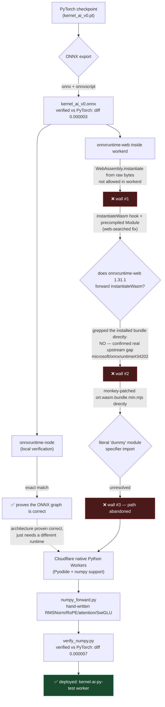

# ARD-003: Serving on Cloudflare Python Workers + pure numpy, after ONNX/onnxruntime-web failed

**Status:** Accepted

## Context

The whole project is built on Cloudflare (Workers, scale-to-zero, no idle
cost — matches en's standing infra preference). Serving a PyTorch-trained
checkpoint inside a Cloudflare Worker needs some runtime that can execute a
forward pass without PyTorch itself (too heavy for a Worker).

## Decision path (what was actually tried, in order)

The ONNX export and onnxruntime-node verification (steps A-E) were not
wasted work — they proved the model's computation graph exports and
matches PyTorch exactly, isolating the failure to "workerd can't run
onnxruntime-web," not "our model/export is broken."

## Decision

Serve via a Cloudflare **Python Worker** (Pyodide runtime, `numpy`
available as a package), running a hand-written pure-numpy reimplementation
of the forward pass (`model/numpy_forward.py`) — RMSNorm, RoPE, QK-norm
attention, SwiGLU, matching the dense (no-MoE) architecture from ARD-001.
Weights are exported to a flat binary format (`export_numpy.py` →
`.npz` initially, later a raw manifest+float32-bytes format to avoid
zip/pickle parsing overhead) and fetched from GitHub at request time
(`raw.githubusercontent.com`), since direct R2 upload was blocked (see
"Rejected alternatives" below).

## Rejected alternatives

- **onnxruntime-web inside Workers** — real, confirmed upstream gap
  (`microsoft/onnxruntime#34202`: `ort.env.wasm.instantiateWasm` doesn't
  forward to the low-level Emscripten factory in v1.31.1's public API).
  A direct monkey-patch of the installed bundle got one layer further but
  hit a second, unrelated wall (a literal `"dummy"` module specifier
  treated as a real import) — abandoned as not worth continued fragile
  patching with no guaranteed payoff.
- **Modal/HF Spaces for serving** — considered when the ONNX path failed,
  but en's explicit standing preference is to keep infra on Cloudflare
  when a working path exists there; Python Workers turned out to be
  exactly that path.
- **R2 for weight storage** — attempted (bucket created successfully) but
  blocked: the OAuth-scoped Cloudflare MCP connector has no
  token-creation permission, and the Cloudflare dashboard itself hit the
  same bot-check wall that blocked LinkedIn automation earlier in the
  project. GitHub raw-file hosting was the workaround — the deployed
  Worker has full internet access at actual runtime (unlike the local dev
  sandbox, which blocks external fetches).

## Consequences

- Serving is genuinely free/scale-to-zero, matching infra preference.
- Known, accepted limitation: cold-start CPU budget (numpy + httpx import
  + first fetch) sits right at the edge of the free Worker's 10ms CPU
  budget, causing **probabilistic 503s on cold edges** — not fixed, and
  not going to be unless the model shrinks further or the plan is
  upgraded; explicitly accepted rather than silently left broken.
- MoE is now a hard non-option for serving (static-graph requirement —
  see ARD-001), locking that decision in beyond just "nice to have."
