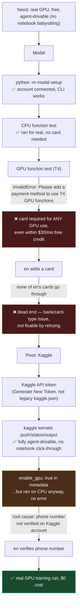

# ARD-004: Training on Kaggle (cardless, API-driven), after Modal's GPU card gate

**Status:** Accepted

## Context

Training (unlike serving) needs a real GPU for a meaningful amount of
wall-clock time. The project wanted this driven end-to-end by the agent,
not a notebook the user has to babysit — consistent with how every other
piece of infra in this project (Cloudflare deploys, GitHub pushes) is
agent-driven via API/CLI rather than manual dashboard clicking.

## Decision path

## Decision

Train on **Kaggle**, driven entirely through its API
(`kaggle kernels push/status/output`) — never a notebook the user clicks
through. A Python script is pushed as a `kernel_type: "script"` kernel with
`enable_gpu: true` and a `dataset_sources` reference to a Kaggle Dataset
holding the training corpus (see RFC-003 for why a Dataset, not GitHub).

## Alternatives considered

- **Modal** — genuinely the better automation story on paper (pure Python
  SDK, no token-flow dance, full programmatic control) and still used
  elsewhere in this project's thinking as the default recommendation when
  a user *has* a working card (see the `free-gpu-training` skill this
  project's work produced) — but hard-blocked here specifically because
  every card en tried failed Modal's verification. This is a bank/card-type
  issue, not something retrying fixes, so it was correctly abandoned
  rather than looped on.
- **Google Colab free tier** — cardless, but has no real push/run/poll API;
  the free tier is notebook-UI-only, which reintroduces the exact
  "user has to babysit a notebook" problem this project is trying to
  avoid. Not chosen.

## Consequences

- Kaggle's API is real but has sharp edges that cost real debugging time:
  `enable_gpu: true` silently falls back to CPU with zero error if the
  account's phone number isn't verified (fixed once en verified it);
  script-type kernel pushes only upload the single `code_file`, so
  `model.py`/`muon.py` had to be inlined into one self-contained file
  rather than imported; the Kaggle username (`karenpearlvpabilando`) is
  not the same as the GitHub username (`pabilandokarenpv`) used
  elsewhere in the project, discovered via an "Invalid Owner Id" error
  only *after* a 98MB dataset upload had already completed.
- Training is genuinely $0 cost, ~30 GPU-hrs/week quota, no card on file
  anywhere in this part of the stack.
- These lessons (card-gate-vs-cardless comparison, the phone-verification
  gotcha, the dataset-mount-path gotcha) were generalized into a reusable
  `free-gpu-training` skill rather than staying one-off tribal knowledge.
