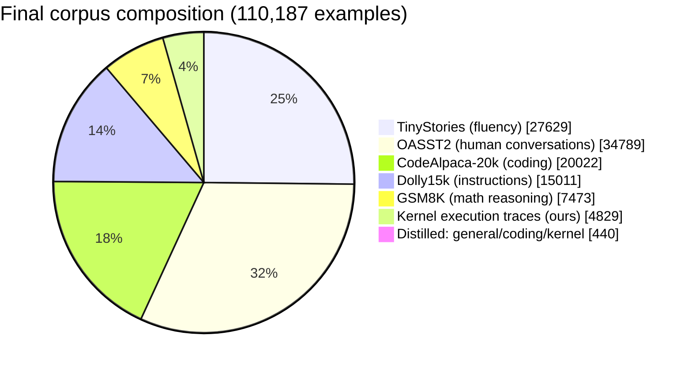

# ARD-005: Data strategy — real open datasets + narrow self-distillation, merged into one corpus

**Status:** Accepted

## Context

The original Kernel-LLM corpus (4,829 Kernel-language execution traces,
generated by `corpus/generate_programs.py` + `corpus/build_corpus.py`) was
designed for a narrow interpretability-research question and is far too
small and too narrow in domain to teach a model to converse like
ChatGPT/Claude at all, let alone about topics outside Kernel programs. The
project's goal broadened explicitly: "feed it data models and more so we
can use it like ChatGPT or Claude... aside from coding too."

## Decision

Build one merged corpus (`data/build_final_corpus.py` →
`kernel_ai_final_corpus.txt`) from multiple real, free, open sources plus
targeted self-distillation:

| Source | License/access | Count | Role |
|---|---|---|---|
| TinyStories | free, HF `roneneldan/TinyStories` | 27,629 | pure fluency |
| OASST2 | free, HF `OpenAssistant/oasst2` | 34,789 (English, deleted-filtered, length-capped) | real human conversations |
| CodeAlpaca-20k | free, HF `sahil2801/CodeAlpaca-20k` | 20,022 | coding instructions |
| Dolly15k | free, HF `databricks/databricks-dolly-15k` | 15,011 | general instructions |
| GSM8K | free, HF `openai/gsm8k` | 7,473 | math reasoning |
| Kernel execution traces | ours, hand-built | 4,829 | Kernel-language semantics |
| Distilled (general/coding/kernel_task/kernel_explain) | generated via gpt-oss-120b, data-gen only (ARD-002) | 440 | fills gaps the above don't cover, esp. Kernel-specific Q&A |

Merged: **110,187 examples, 99MB**, tokenized with a freshly retrained
24.5k-vocab BPE tokenizer (`train_assistant_tokenizer.py`).

## Alternatives considered

- **Kernel corpus alone** — rejected: answers the interpretability
  question but produces a model that can only ever discuss Kernel
  programs, failing the "use it like ChatGPT" goal entirely.
- **100% distilled data (no real datasets)** — rejected: would make the
  served model's "knowledge" entirely a compressed copy of one teacher
  model's outputs with no real diversity; mixing in large, genuinely
  human-sourced/free datasets (OASST2 especially — real human
  conversations) gives more honest diversity and reduces dependence on
  distillation quality/cost.
- **OASST2 used unfiltered** — rejected: raw OASST2 is a tree-structured
  multi-lingual dataset; naive flattening would pull in non-English and
  deleted/low-quality branches. Filtered to English-only,
  non-deleted, length-capped prompter→assistant pairs by walking the
  message tree and matching `parent_id` links.

## Consequences

- GitHub's 100MB per-file limit means the 99MB merged corpus text file is
  `.gitignore`d (regenerable from `build_final_corpus.py` + raw sources,
  not meant to be a committed artifact) — and is instead uploaded as a
  **Kaggle Dataset** for the training run (see RFC-003), not fetched from
  GitHub.
- Corpus composition is heavily weighted toward general English
  conversation/instructions (77,293 of 110,187 examples) vs. Kernel-specific
  content (5,269 of 110,187) — intentional, since the "talk like
  ChatGPT" goal needs broad coverage and Kernel-specific depth is a
  secondary goal layered on top, not the primary one anymore.
- Tokenizer vocab grew from the original 1,195 (Kernel-only BPE) to 24,576
  to handle the much broader vocabulary of natural English + code,
  trained fresh on the full merged corpus.
