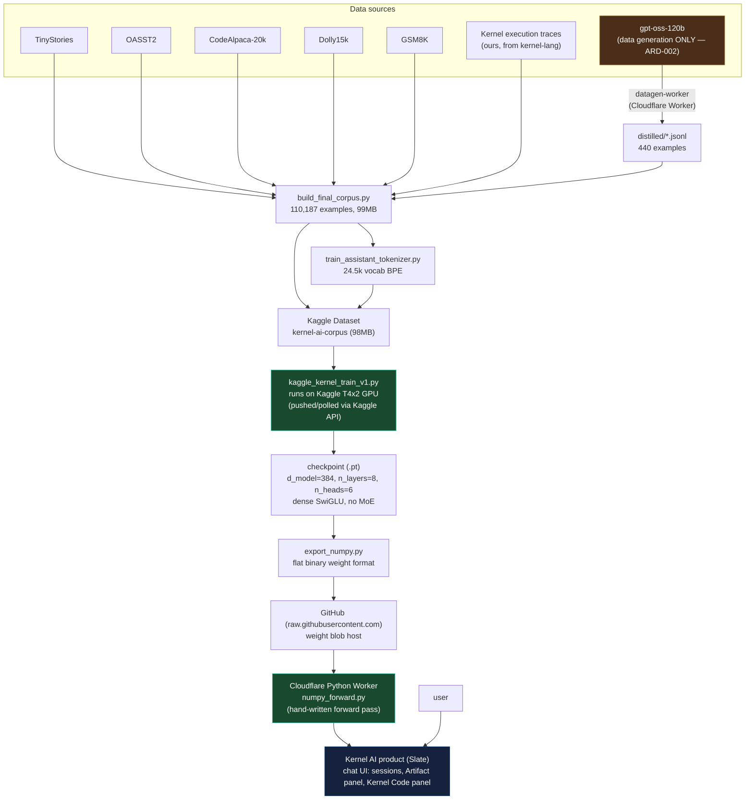

# RFC-001: End-to-end system architecture

**Status:** Implemented (training in progress at time of writing)

## Summary

Kernel AI has two halves that run on different infrastructure, connected
by a GitHub-and-Kaggle-hosted checkpoint handoff: **training** (Kaggle,
GPU, batch) and **serving** (Cloudflare Workers, scale-to-zero, request-
driven). Both are agent-drivable end to end via API/CLI — no manual
notebook-clicking or dashboard-only steps anywhere in the loop except the
one-time account setup each platform requires.

## Full system diagram

## Why two different cloud platforms

| Concern | Platform | Why |
|---|---|---|
| Training (batch, GPU-hungry, hours) | Kaggle | Free GPU quota (~30 hrs/week), cardless, real API — see ARD-004 |
| Serving (request-driven, must be cheap at near-zero traffic) | Cloudflare Workers | Scale-to-zero, matches en's standing infra preference, Python Workers support numpy — see ARD-003 |

Training and serving are explicitly treated as **separable concerns** —
committing to Cloudflare for serving never implied Cloudflare for training;
Kaggle was chosen for training purely on its own merits (free GPU,
cardless, automatable).

## The handoff: checkpoint → servable weights

A checkpoint trained on Kaggle isn't directly servable — it's a PyTorch
`.pt` file, and the Worker has no PyTorch. `export_numpy.py` flattens the
state dict into a manifest + raw float32 byte format (chosen over `.npz`
specifically because zip/pickle parsing was the actual CPU-budget
bottleneck on Worker cold start, not the matmuls — see ARD-003), and the
Worker fetches it live from GitHub at request time.

## Product surface

The trained model is wrapped in "Kernel AI" (built on the `slate`
Cloudflare Worker) — a chat interface with sessions, an Artifact panel, and
a Kernel Code panel, deliberately modeled on the ChatGPT/Claude/Claude Code
structural pattern. See `product/PRDs/PRD-001-kernel-ai-product.md` for the
product requirements and `engineering/RFCs/RFC-004-serving-pipeline.md`
for exactly how a chat request becomes a model response.
