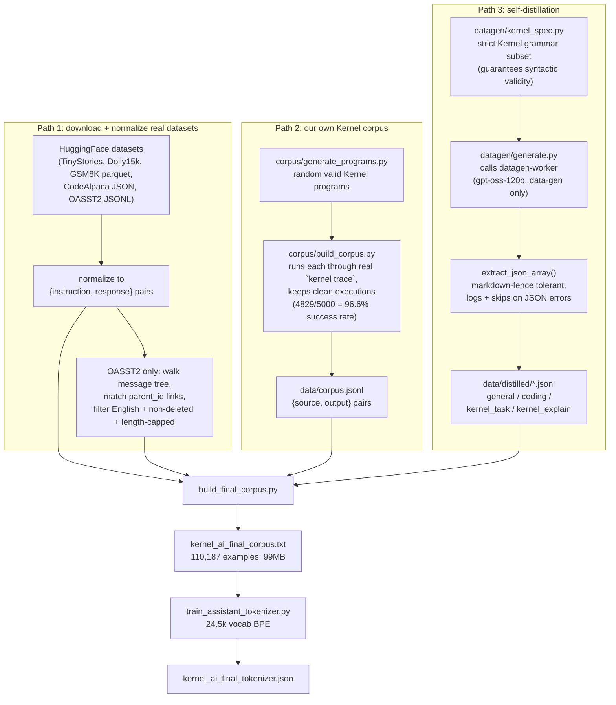

# RFC-002: Data pipeline — corpus assembly, tokenization, distillation

**Status:** Implemented

## Summary

Three data-production paths feed one merge step. This RFC covers each
path's mechanics; see ARD-005 for the sourcing rationale.

## Diagram: three paths into one corpus



## Path 1 detail: real dataset normalization

All instruction-style sources (Dolly, CodeAlpaca, GSM8K) are normalized to
the same `{"instruction": ..., "response": ...}` shape regardless of their
original field names, so `build_final_corpus.py` can format every source
identically as:

```
### Instruction:
<instruction text>

### Response:
<response text>
```

OASST2 is the one source needing real processing: it's a tree of messages
(each with a `message_id`/`parent_id`/`role`/`lang`/`deleted` field, not
flat pairs). The pipeline loads every message into a dict keyed by
`message_id`, then for every `role=="assistant"` message walks to its
`parent_id` — if the parent is `role=="prompter"`, both are English, and
neither is deleted, it becomes one training pair. This produced 34,789
pairs from the raw dataset.

## Path 2 detail: zero-contamination Kernel corpus

This is the only path where "ground truth" is defined by actually running
code, not by a model's claim about what code does: `generate_programs.py`
emits random, syntactically-valid Kernel programs (bounded depth, int
arithmetic, control flow), and `build_corpus.py` runs each one through the
**real** Kernel interpreter (`kernel trace`), keeping only programs that
execute cleanly. The resulting `{source, output}` pairs are reformatted in
`build_final_corpus.py` as a "what does this program print?" instruction,
with long outputs truncated at 40 lines.

## Path 3 detail: constrained distillation

`datagen/kernel_spec.py` defines a strict Kernel grammar subset (the same
core v1 language from kernel-lang: `fn main()`, `let`/reassignment,
`print`, `if/elif/else`, `for v in lo..hi`, `while` with a decrementing
counter, `+-*%`, comparisons) and hands it to the teacher model as a
constraint, so generated `kernel_task`/`kernel_explain` examples are
syntactically valid Kernel by construction rather than hoped-for. Real
failure modes hit and fixed here:

- `content: null` responses — gpt-oss spent its entire token budget on
  internal chain-of-thought before answering. Fixed with `max_tokens: 4096`
  + `reasoning: {effort: "low"}` on the Worker call.
- JSON parse failures on code-heavy generations (nested quotes breaking
  string escaping) — `extract_json_array()` hardened to strip markdown
  fences and log the raw text on failure instead of crashing the whole
  batch; batch size reduced 8→5 to lower truncation risk.

## Final merge

`build_final_corpus.py` concatenates every source's examples (TinyStories
as raw `<|endoftext|>`-delimited text; everything else as
`### Instruction:` / `### Response:` blocks) into one text file, then a
fresh tokenizer is trained on the complete mix — not reused from the
earlier Kernel-only tokenizer (vocab 1,195), since the vocabulary need
changed completely once natural English dominates the corpus.
