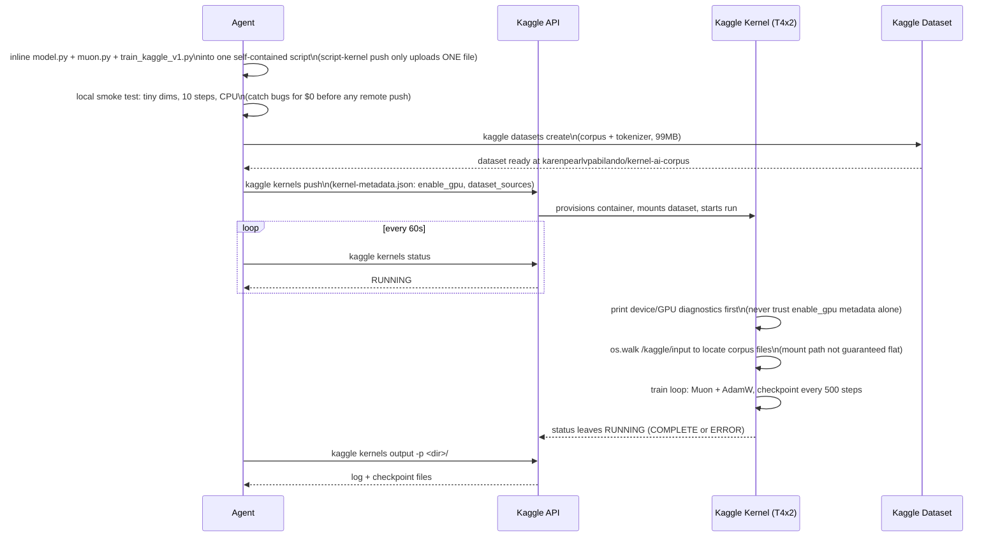

# RFC-003: Training pipeline — Kaggle API push/poll/output workflow

**Status:** Implemented, first real run in progress at time of writing

## Summary

The training script is pushed to Kaggle, run on a real T4x2 GPU, and
monitored — all via the Kaggle API, with no notebook UI involved at any
step. This RFC documents the exact workflow and the real sharp edges hit
building it (see ARD-004 for why Kaggle over Modal).

## Workflow diagram

## Real bugs hit building this (each one real, not hypothetical)

| Bug | Symptom | Root cause | Fix |
|---|---|---|---|
| Dataset owner mismatch | `Dataset creation error: Invalid Owner Id`, **after** a full 98MB upload completed | Guessed the Kaggle username from the GitHub username (`pabilandokarenpv`) — they differ | `kaggle config view` gives the real username (`karenpearlvpabilando`) — read it, never assume it matches another platform |
| GPU silently not attached | Log printed `device: cpu` despite `enable_gpu: true` in metadata, no error at all | Kaggle requires phone-number verification before granting a real GPU; unverified accounts get silently downgraded to CPU | en verified phone number on Kaggle; script now prints `torch.cuda.is_available()` + device name as its first lines specifically so this is never silently missed again |
| Dataset not found at runtime | `FileNotFoundError` for a file that *is* in the attached dataset | Kaggle's dataset mount path isn't the flat `/kaggle/input/<slug>/` assumed — it can nest under a `datasets/` subfolder | Script does `os.walk('/kaggle/input')` to find the expected filenames anywhere in the tree, and prints the whole tree as a diagnostic on every run |
| `ModuleNotFoundError` risk (caught before it happened) | — | Script-type kernel pushes upload only the single `code_file`; local `model.py`/`muon.py` imports would not be included | Built a generator step that strips each source file's docstring/import header and concatenates the bodies into one self-contained file, regenerated before every push — the multi-file version stays the one used for local dev/testing |
| Kernel title/id slug mismatch | Warning on push, later a `409 Conflict` | Kaggle derives a slug from the kernel title; a title that doesn't resolve to the specified `id` causes inconsistent behavior | Made the title resolve to the same slug as the id (`Kernel AI v1 Training` → `kernel-ai-v1-training`) |

## Training config (v1 run)

| Parameter | Value |
|---|---|
| Architecture | dense SwiGLU, no MoE (matches serving — ARD-001) |
| d_model / n_layers / n_heads | 384 / 8 / 6 |
| Sequence length | 256 |
| Batch size | 24 |
| Total steps | 6,000 |
| Checkpoint cadence | every 500 steps |
| Optimizer | Muon (lr 0.02) for 2D hidden matrices, AdamW (lr 3e-4) for embeddings/norms/head |
| Data | full 110,187-example merged corpus, via Kaggle Dataset |

## Before every remote push

Every version of the training script was run locally first with sizes and
step counts monkey-patched down (tiny dims, ~10 steps, a capped slice of
the corpus) to catch real import/logic bugs in seconds for $0, before
spending a multi-minute remote cold start finding out the same bug burns
real GPU quota instead.
