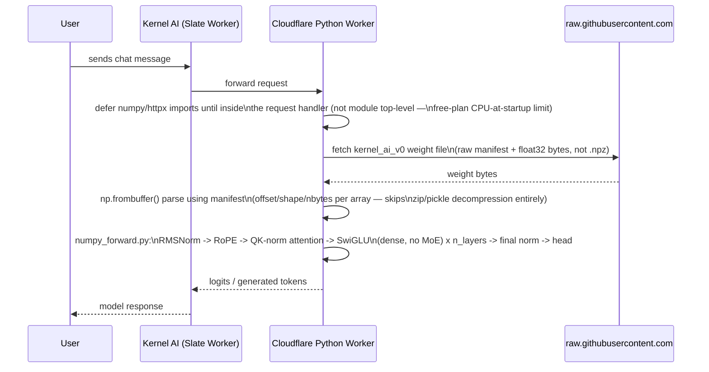

# RFC-004: Serving pipeline — numpy forward pass on Cloudflare Python Workers

**Status:** Implemented (`kernel-ai-py-test` worker); known cold-start
limitation accepted, not fixed

## Summary

A trained checkpoint becomes a chat response through a request-time numpy
forward pass running inside a Cloudflare Python Worker — no PyTorch, no
ONNX runtime, just a hand-written reimplementation of the model's math
verified to match PyTorch's output to 7 significant digits.

## Request flow diagram

## Why the weight format changed twice

1. **First attempt**: `.npz` (NumPy's zip-based format). Worked, but
   profiling showed the actual cold-start bottleneck was `.npz`
   decompression/parsing, not the matmuls (forward pass measured ~0ms
   once weights were loaded).
2. **Final format**: a raw flat binary — a small JSON manifest (array
   names, shapes, byte offsets) followed by concatenated raw float32
   bytes, parsed with `np.frombuffer()` and zero decompression. This is
   the format actually deployed.

## Why weights are fetched from GitHub, not bundled or R2

- **Bundling into the Worker**: Workers have deployment size limits; a
  30MB+ weight file inline is impractical.
- **R2 (the "correct" tool for this)**: attempted — a bucket was created
  successfully, but the OAuth-scoped Cloudflare connector has no
  permission to create the access tokens needed to actually upload to it,
  and the Cloudflare dashboard itself hit the same bot-check wall that
  blocked LinkedIn automation earlier in the project.
- **GitHub raw-file hosting**: the workaround that actually works — a
  deployed Worker has full internet access at real runtime (unlike the
  local dev sandbox, which blocks external fetches entirely), so
  `raw.githubusercontent.com` serves as a free, good-enough blob host.

## Known, accepted limitation: probabilistic cold-start 503s

Importing `numpy`+`httpx` plus the first GitHub fetch sits right at the
edge of the free Python Worker's 10ms CPU budget. This produces
**intermittent** 503s on cold edges — not deterministic, not every
request, but real. This was explicitly accepted rather than fixed (options
not taken: shrink the model further, or pay for a higher CPU-time plan) —
documented here so it's a known tradeoff, not a silently discovered bug
later.

## Hard constraint this imposes upstream

Because this serving path needs a static computation graph parsed by hand
into numpy ops, **MoE is not an option** for the served model — dynamic
top-k routing has no clean numpy equivalent without reimplementing
dispatch logic that defeats the simplicity this whole approach is for. See
ARD-001 for how this became a training-architecture constraint, not just a
serving detail.
