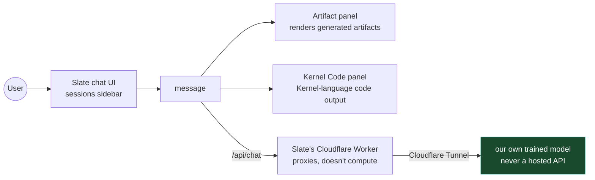

# PRD-001: Kernel AI

**Status:** Product shell (Slate) shipped and deployed; first real training
run on Kaggle completed — val_loss 10.08 → 2.27 over 6,000 steps, confirmed
real (not a smoke test). Slate's chat is now wired to the real checkpoint
(no more placeholder) via a Cloudflare Tunnel, $0 cost, verified end-to-end
with a real generation through the live product.

## Problem

en wants a ChatGPT/Claude-style product — chat with sessions, live
artifacts, a code panel — but powered by a model that is genuinely "ours,"
the same way every major lab's assistant is powered by their own trained
model, not a resale of someone else's API. Existing options are either
(a) wrap a hosted API (fast, but not "built from scratch" by any honest
definition) or (b) fine-tune an existing open model (still not from
scratch — it starts from someone else's pretrained weights). Neither
satisfies the actual goal.

## Goals

- G1: A chat product with the same structural shape as ChatGPT/Claude/
  Claude Code — sessions, an Artifact panel, a Kernel Code panel — not a
  bare text box.
- G2: Every response the user sees comes from a model trained entirely by
  us, from random initialization, on data we assembled — never a hosted
  model answering directly (see ARD-002).
- G3: $0 ongoing infrastructure cost at low/personal-scale traffic —
  matches en's standing infra preference (scale-to-zero, no idle cost).
- G4: The model should be broadly conversational ("like ChatGPT/Claude"),
  not narrowly limited to Kernel-language topics — while *also* retaining
  real competence on Kernel specifically, since that's this project's
  unique angle no other assistant has.

## Non-goals

- Matching GPT-4/Claude-tier capability. The served model (tens of
  millions of parameters, trained on free GPU compute) is honestly, and
  by design, far below frontier-model capability. The goal is a working,
  genuinely-ours pipeline end to end — not competing on raw capability.
- Multi-user production scale. This is personal-use-first (matches en's
  standing pattern for the Apple-app projects too) — the architecture
  happens to be cheap at scale, but scale isn't a design target.
- Fine-tuning or distilling the served model's *weights* directly from the
  teacher model. The teacher (gpt-oss-120b) only ever produces *training
  examples* that get mixed into the corpus — see ARD-002, this line is
  intentionally never crossed.

## Target users

- **Primary**: en — personal use, and the flagship example in a planned
  build-in-public series (LinkedIn/TikTok/X/Reddit) + research-paper-style
  writeups (Medium/Devpost/envember.com) across a ~20-project portfolio.
- **Secondary**: none planned yet.

## Requirements

| # | Requirement | Status |
|---|---|---|
| R1 | Chat UI with persistent sessions (sidebar, new-session) | ✅ shipped |
| R2 | Artifact panel (renders model-produced artifacts) | ✅ shipped |
| R3 | Kernel Code panel (runs/displays Kernel-language code) | ✅ shipped |
| R4 | Responsive across desktop / tablet / phone | ✅ shipped, verified at 3 breakpoints |
| R5 | Model is trained from random init, not fine-tuned from an existing pretrained model | ✅ by construction (`model.py` is a from-scratch architecture, Kaggle run starts from fresh weights) |
| R6 | No hosted model ever answers a real user message | ✅ now genuinely true — Slate's `/api/chat` calls our own checkpoint via the Cloudflare Tunnel; previously true only vacuously (a placeholder that answered nothing real), now backed by real generation |
| R7 | Training data includes broad, real, free English/code/reasoning sources, not just Kernel-language content | ✅ shipped (ARD-005) — 110,187-example merged corpus |
| R8 | $0 serving cost at low traffic | ✅ shipped — Cloudflare Tunnel to a persistent process, genuinely $0, no card, no per-request CPU-time wall (that specific wall killed the Workers-only path — see ARD-003). Live at https://kernel-ai.forgirlswhobuild.com/, verified end-to-end via `gradio_client` against the real public URL. |
| R9 | $0 training cost | ✅ Kaggle free GPU quota, cardless (ARD-004) |
| R10 | Real trained checkpoint, verified against a genuine training run (not a smoke test claimed as "done") | ✅ shipped — 6,000 steps on Kaggle T4, val_loss 10.08 → 2.27, sample generations verified real (coherent English prose, structurally valid Kernel syntax, correct GSM8K answer-format though not yet reliably correct arithmetic) |

## User-facing architecture (what the user actually sees)

## Success criteria

- A real user conversation, end to end, answered entirely by our own
  checkpoint, with no fabricated/assumed output — the standing project
  rule throughout has been to report real tool/training output, including
  garbled early-stage generations, rather than claim success without
  evidence.
- Loss curve from a real training run (not a CPU smoke test) demonstrating
  the model is actually learning on the full merged corpus.
- The product (Slate, aka Kernel AI) is live and responsive at
  https://slate.pabilando-karenpv.workers.dev — chat, sidebar/sessions,
  Artifact panel, Kernel Code panel, and now a real backend: the
  trained checkpoint, not the hosted-model interim. Verified via browser
  automation: opened the sidebar, sent a real message, watched a real
  generated response stream in ("Once upon a time there was a small
  girl named Jo...").

## Open items at time of writing

- First full training run complete: 6,000 steps, dense 384d/8L/6h, Kaggle
  T4, ~46 min wall clock, val_loss 10.08 → 2.27. Sample generations
  verified real (not cherry-picked): coherent English story continuations,
  structurally valid Kernel syntax (correct indentation/nesting), and
  correct GSM8K-style `<<...>>` answer formatting (arithmetic itself not
  yet reliably correct — honestly reported, not glossed over).
- **Serving is live, now wired into the real product**: Slate
  (https://slate.pabilando-karenpv.workers.dev) is the actual chat
  UI — sidebar, sessions, Artifact panel, Kernel Code panel, all of
  which were already built and are not a separate demo. Its
  `/api/chat` Worker proxies to
  https://kernel-ai.forgirlswhobuild.com/api/generate, a Cloudflare
  Tunnel (genuinely $0, no card, no per-request CPU-time wall since
  compute runs on real persistent infrastructure rather than inside a
  Worker) pointed at the real checkpoint via the same pure-numpy
  forward pass built for the abandoned Workers path. A standalone
  Gradio demo at the tunnel's root URL still exists too (useful for
  direct testing without going through Slate), but Slate is the actual
  product surface. Verified end-to-end through the live Slate UI via
  browser automation: real message sent, real generated response
  streamed back. This is what actually shipped, after both of the
  other two serving paths considered turned out to be paid-only:
  - Cloudflare Workers Free: confirmed hard 10ms CPU-time/request wall
    (see ARD-003's earlier revisions) — would need Workers Paid, $5/mo.
  - HF Spaces: confirmed (real 402 error, not a guess) that hosting any
    Gradio/Docker Space on compute now requires HF PRO, $9/mo — a policy
    HF apparently tightened at some point, since free CPU Basic Gradio
    Spaces used to be the default assumption.
